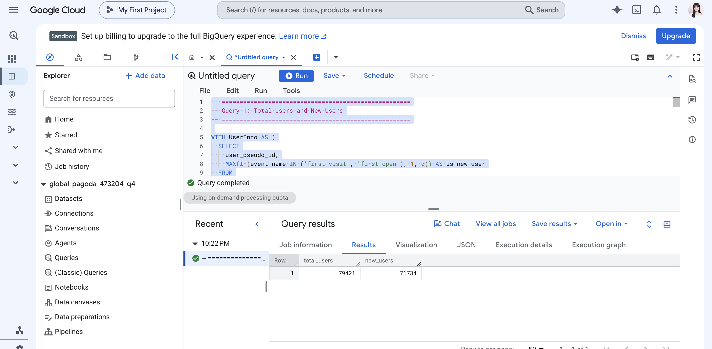
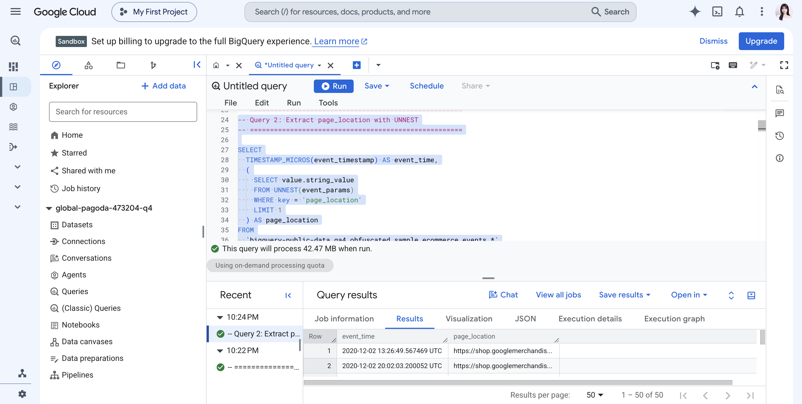
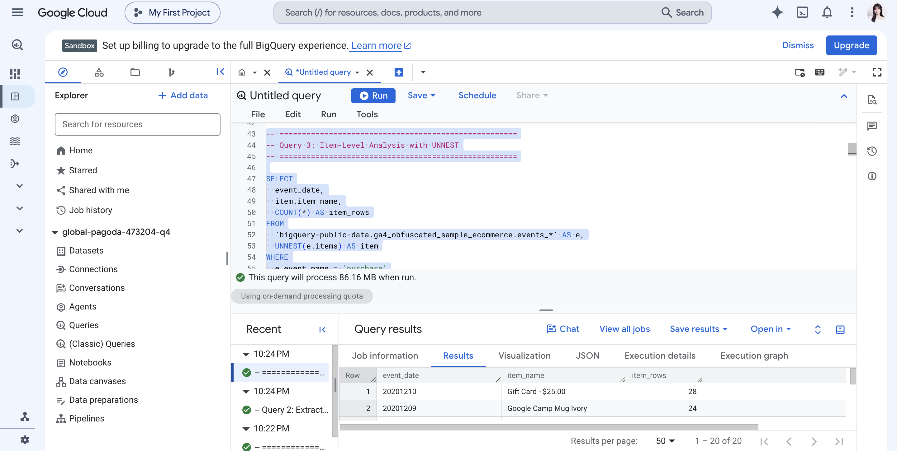
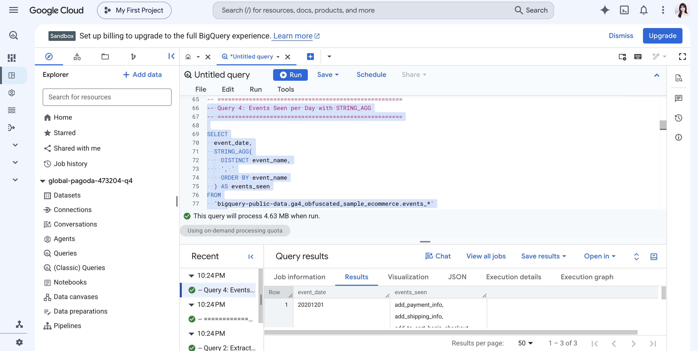
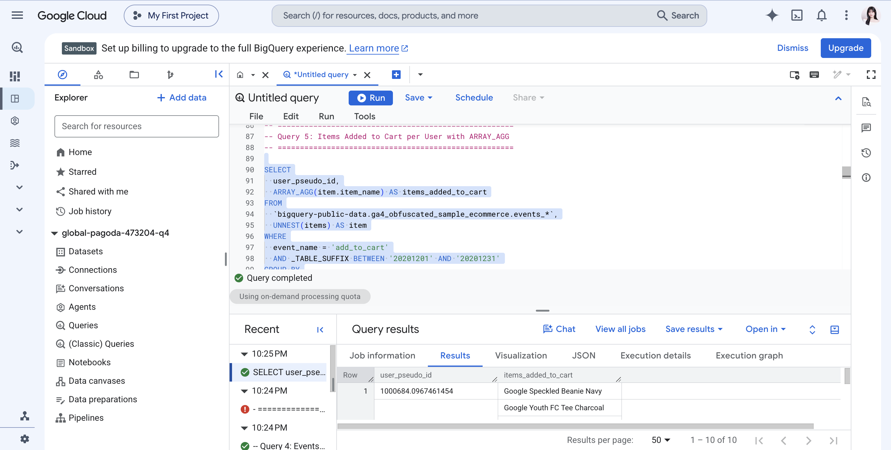
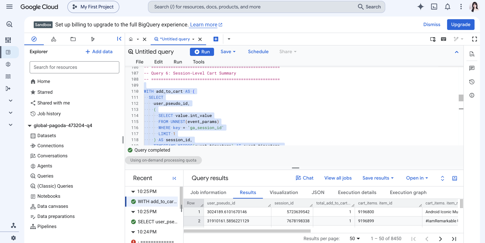
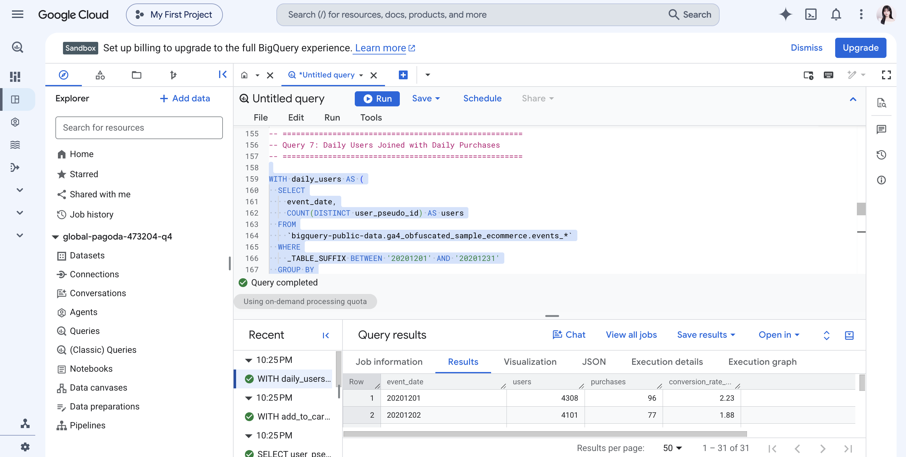
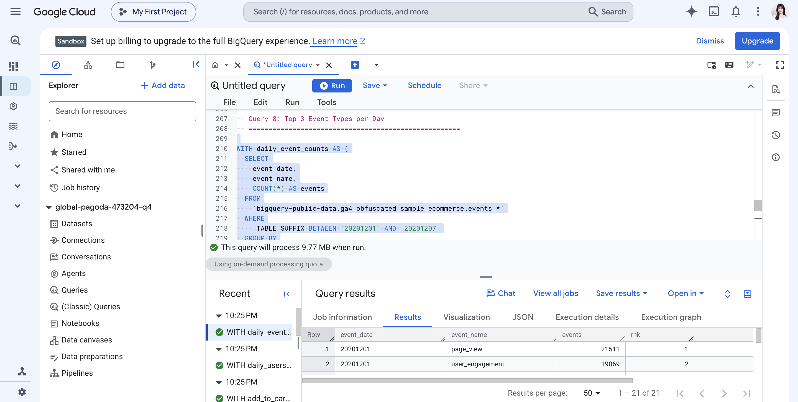
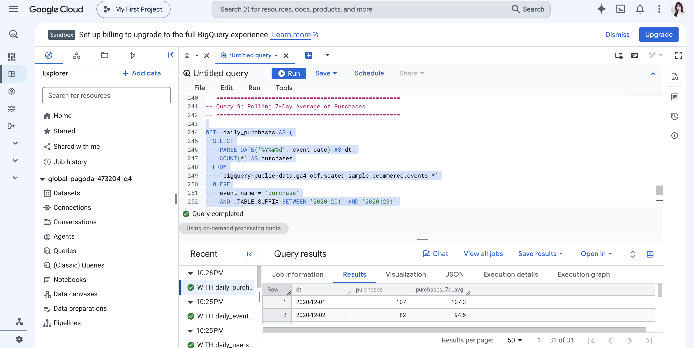
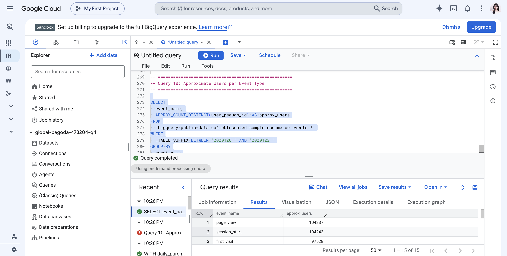

# Introduction

This document organizes the SQL queries from Lecture 2. The queries use the GA4 sample ecommerce dataset in BigQuery. For each query, I included the SQL code, a short explanation, and a place for the screenshot of the query output.

## Dataset

The queries use the following public GA4 sample table:

```text
bigquery-public-data.ga4_obfuscated_sample_ecommerce.events_*
```

The `_TABLE_SUFFIX` filter is included in each query to limit the date range and reduce unnecessary data scanning.

## Query 1 — Total Users and New Users

```{.sql}
WITH UserInfo AS (
  SELECT
    user_pseudo_id,
    MAX(IF(event_name IN ('first_visit', 'first_open'), 1, 0)) AS is_new_user
  FROM
    `bigquery-public-data.ga4_obfuscated_sample_ecommerce.events_*`
  WHERE
    _TABLE_SUFFIX BETWEEN '20201101' AND '20201130'
  GROUP BY
    user_pseudo_id
)

SELECT
  COUNT(*) AS total_users,
  SUM(is_new_user) AS new_users
FROM UserInfo;
```

**This query answers:** How many total users and new users were recorded during the selected date range?

**It works by:** First creating one row per user with a CTE, then identifying users who had a `first_visit` or `first_open` event.

**Caveat:** `user_pseudo_id` is an anonymous GA4 identifier. The result should not be interpreted as a guaranteed count of individual people.

### Query 1 Output



## Query 2 — Extract `page_location` with `UNNEST`

```{.sql}
SELECT
  TIMESTAMP_MICROS(event_timestamp) AS event_time,
  (
    SELECT value.string_value
    FROM UNNEST(event_params)
    WHERE key = 'page_location'
    LIMIT 1
  ) AS page_location
FROM
  `bigquery-public-data.ga4_obfuscated_sample_ecommerce.events_*`
WHERE
  event_name = 'page_view'
  AND _TABLE_SUFFIX BETWEEN '20201201' AND '20201202'
LIMIT 50;
```

**This query answers:** What page URLs were recorded in page-view events?

**It works by:** Searching the repeated `event_params` array for the key `page_location` and returning its string value.

**Caveat:** URL query parameters may cause the same page to appear as multiple different URLs.

### Query 2 Output



## Query 3 — Item-Level Purchase Analysis

```{.sql}
SELECT
  event_date,
  item.item_name,
  COUNT(*) AS item_rows
FROM
  `bigquery-public-data.ga4_obfuscated_sample_ecommerce.events_*` AS e,
  UNNEST(e.items) AS item
WHERE
  e.event_name = 'purchase'
  AND _TABLE_SUFFIX BETWEEN '20201201' AND '20201231'
GROUP BY
  event_date,
  item.item_name
ORDER BY
  item_rows DESC
LIMIT 20;
```

**This query answers:** Which products appeared most often in purchase events?

**It works by:** Flattening the `items` array so that each item becomes a separate row, then counting item rows by date and product name.

**Caveat:** After `UNNEST(items)`, the grain changes from event-level to item-level. One purchase event can produce multiple rows.

### Query 3 Output



## Query 4 — Events Seen per Day with `STRING_AGG`

```{.sql}
SELECT
  event_date,
  STRING_AGG(
    DISTINCT event_name,
    ', '
    ORDER BY event_name
  ) AS events_seen
FROM
  `bigquery-public-data.ga4_obfuscated_sample_ecommerce.events_*`
WHERE
  _TABLE_SUFFIX BETWEEN '20201201' AND '20201203'
GROUP BY
  event_date
ORDER BY
  event_date;
```

**This query answers:** Which event types were recorded on each day?

**It works by:** Grouping events by date and combining the distinct event names into one comma-separated value.

**Caveat:** This output shows whether an event type occurred, not how many times it occurred.

### Query 4 Output



## Query 5 — Items Added to Cart per User

```{.sql}
SELECT
  user_pseudo_id,
  ARRAY_AGG(item.item_name) AS items_added_to_cart
FROM
  `bigquery-public-data.ga4_obfuscated_sample_ecommerce.events_*`,
  UNNEST(items) AS item
WHERE
  event_name = 'add_to_cart'
  AND _TABLE_SUFFIX BETWEEN '20201201' AND '20201231'
GROUP BY
  user_pseudo_id
ORDER BY
  user_pseudo_id
LIMIT 10;
```

**This query answers:** Which products did each user add to a cart during the selected period?

**It works by:** Flattening the item array and then using `ARRAY_AGG` to place each user's item names into an array.

**Caveat:** The result shows item names, but it does not summarize total quantity or revenue for each user.

### Query 5 Output



## Query 6 — Session-Level Cart Summary

```{.sql}
WITH add_to_cart AS (
  SELECT
    user_pseudo_id,
    (
      SELECT value.int_value
      FROM UNNEST(event_params)
      WHERE key = 'ga_session_id'
      LIMIT 1
    ) AS session_id,
    TIMESTAMP_MICROS(event_timestamp) AS event_timestamp,
    i.item_id,
    i.item_name,
    i.quantity,
    i.price
  FROM
    `bigquery-public-data.ga4_obfuscated_sample_ecommerce.events_*`,
    UNNEST(items) AS i
  WHERE
    event_name = 'add_to_cart'
    AND _TABLE_SUFFIX BETWEEN '20201201' AND '20201231'
)

SELECT
  user_pseudo_id,
  session_id,
  COUNT(*) AS total_add_to_cart_events,
  ARRAY_AGG(
    STRUCT(item_id, item_name, quantity, price, event_timestamp)
    ORDER BY quantity DESC, event_timestamp ASC
    LIMIT 10
  ) AS cart_items
FROM add_to_cart
WHERE session_id IS NOT NULL
GROUP BY
  user_pseudo_id,
  session_id;
```

**This query answers:** What items were added to each user's cart session?

**It works by:** Extracting the integer session ID from `event_params`, flattening the item array, and then building a structured array of cart items.

**Caveat:** A session ID is normally interpreted together with a user ID. The query therefore groups by both `user_pseudo_id` and `session_id`.

### Query 6 Output



## Query 7 — Daily Users Joined with Daily Purchases

```{.sql}
WITH daily_users AS (
  SELECT
    event_date,
    COUNT(DISTINCT user_pseudo_id) AS users
  FROM
    `bigquery-public-data.ga4_obfuscated_sample_ecommerce.events_*`
  WHERE
    _TABLE_SUFFIX BETWEEN '20201201' AND '20201231'
  GROUP BY
    event_date
),

daily_purchases AS (
  SELECT
    event_date,
    COUNT(
      DISTINCT (
        SELECT value.string_value
        FROM UNNEST(event_params)
        WHERE key = 'transaction_id'
        LIMIT 1
      )
    ) AS purchases
  FROM
    `bigquery-public-data.ga4_obfuscated_sample_ecommerce.events_*`
  WHERE
    event_name = 'purchase'
    AND _TABLE_SUFFIX BETWEEN '20201201' AND '20201231'
  GROUP BY
    event_date
)

SELECT
  u.event_date,
  u.users,
  IFNULL(p.purchases, 0) AS purchases,
  ROUND(
    IFNULL(p.purchases, 0) / NULLIF(u.users, 0) * 100,
    2
  ) AS conversion_rate_pct
FROM daily_users AS u
LEFT JOIN daily_purchases AS p
  ON u.event_date = p.event_date
ORDER BY
  u.event_date;
```

**This query answers:** How did daily users compare with daily purchase transactions?

**It works by:** Creating two daily summary tables with CTEs and joining them by `event_date`. `IFNULL` changes missing purchase values to zero.

**Caveat:** The calculated rate compares transactions with users, so it is a simple daily purchase rate rather than a complete GA4 conversion metric.

### Query 7 Output



## Query 8 — Top Three Event Types per Day

```{.sql}
WITH daily_event_counts AS (
  SELECT
    event_date,
    event_name,
    COUNT(*) AS events
  FROM
    `bigquery-public-data.ga4_obfuscated_sample_ecommerce.events_*`
  WHERE
    _TABLE_SUFFIX BETWEEN '20201201' AND '20201207'
  GROUP BY
    event_date,
    event_name
)

SELECT
  event_date,
  event_name,
  events,
  RANK() OVER (
    PARTITION BY event_date
    ORDER BY events DESC
  ) AS rnk
FROM daily_event_counts
QUALIFY rnk <= 3
ORDER BY
  event_date,
  rnk;
```

**This query answers:** What were the three most common event types on each day?

**It works by:** Counting events by day and event name, then using `RANK()` and `QUALIFY` to keep the top three event types for each date.

**Caveat:** Ties can result in more than three rows for a day because `RANK()` gives tied values the same rank.

### Query 8 Output



## Query 9 — Rolling Seven-Day Average of Purchases

```{.sql}
WITH daily_purchases AS (
  SELECT
    PARSE_DATE('%Y%m%d', event_date) AS dt,
    COUNT(*) AS purchases
  FROM
    `bigquery-public-data.ga4_obfuscated_sample_ecommerce.events_*`
  WHERE
    event_name = 'purchase'
    AND _TABLE_SUFFIX BETWEEN '20201201' AND '20201231'
  GROUP BY
    dt
)

SELECT
  dt,
  purchases,
  AVG(purchases) OVER (
    ORDER BY dt
    ROWS BETWEEN 6 PRECEDING AND CURRENT ROW
  ) AS purchases_7d_avg
FROM daily_purchases
ORDER BY
  dt;
```

**This query answers:** How did the seven-day average of purchases change over time?

**It works by:** First calculating daily purchases, then using a window function to average the current day and the previous six available rows.

**Caveat:** The first few dates use fewer than seven observations because there are not yet six previous dates in the result.

### Query 9 Output



## Query 10 — Approximate Users per Event Type

```{.sql}
SELECT
  event_name,
  APPROX_COUNT_DISTINCT(user_pseudo_id) AS approx_users
FROM
  `bigquery-public-data.ga4_obfuscated_sample_ecommerce.events_*`
WHERE
  _TABLE_SUFFIX BETWEEN '20201201' AND '20201231'
GROUP BY
  event_name
ORDER BY
  approx_users DESC
LIMIT 15;
```

**This query answers:** How many approximate users were associated with each event type?

**It works by:** Grouping events by event name and using `APPROX_COUNT_DISTINCT` to estimate the number of unique users.

**Caveat:** The result is an estimate, not an exact distinct-user count. This function is useful when performance matters on very large datasets.

### Query 10 Output



# Summary

Lecture 2 introduced CTEs, arrays, `UNNEST`, aggregation functions, joins, window functions, `QUALIFY`, and approximate functions. These examples showed that the meaning of a result depends on the level of analysis, such as event-level, item-level, user-level, or session-level data.

# Appendix: Submission Links

- [GitHub Repository](PASTE-GITHUB-REPOSITORY-LINK-HERE)
- [GitHub Pages](PASTE-GITHUB-PAGES-LINK-HERE)
